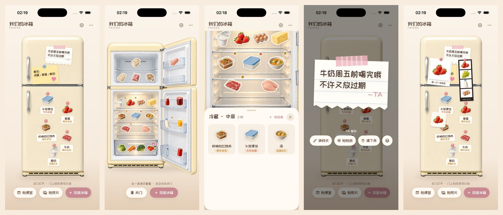

# 我们的冰箱 · snug fridge

一台可以开门、贴贴纸、贴便签、贴照片的复古冰箱。用 **SwiftUI** 写的 iOS 小页面，原本是我和 TA 共用的一个 app 里的「冰箱」页，拆出来做成了可以单独跑的 demo。

**[在浏览器里直接试玩](https://51enuxu.github.io/snug-fridge/web/)**（网页版，手机打开效果最好）



---

## 能做什么

- **开门关门**：点门，门先转开，再把门内侧转平，镜头跟着从「只看箱体」推到「箱体加两扇门」。
- **按层摆放**：冷冻上下层、冷藏三层、蔬果抽屉、门架上中下、冷冻门架上下，每样东西是一张小贴纸，一层超过 4 样会叠起来显示 +N。
- **点一层推近看**：镜头推近这一层，底下浮出这一层的全部东西（名字、还能放几天）。
- **放进冰箱**：41 张内置食物贴纸，按分类挑；「建议吃完」按食物种类和放的位置自动填一个天数，也可以点「3 天 / 1 周 / 1 个月」快速改。也能拍照，自动抠出主体，做成自己的贴纸（只有 iOS 版有）。
- **吃掉 / 扔掉**：吃掉时贴纸从一角软软地揭下来；过期的东西按钮会变成「扔掉」。
- **快到期提醒**：两天内要吃掉的，会自动贴到门外，用磁铁压着。
- **门上便签**：6 种纸、8 种固定方式（磁铁、胶带），4 种字体，字号可调，能贴装饰小贴纸，能拖动；点开放大编辑，揭下来时先拿掉磁铁或胶带再把纸拿走。
- **门上照片**：抠图贴、拍立得、人生四格。可以换相框颜色、换顶上的磁铁或胶带、在框里挪构图和转方向，在门上拖动、旋转。
- **上下顺序**：门上的便签和照片可以「放到最上面 / 最下面」。
- **今天吃什么**：自带 353 道家常菜的菜谱库，按冰箱里有的东西挑出「现在就能做」和「差一两样」的，快过期的优先；点进去看用料（标出冰箱有 / 调料 / 要买）和步骤，做完点「做了这道」，勾上的东西各吃掉一份。
- **换漆面颜色**：7 种预设，也可以自己调。
- **和 TA 共用**（可选）：接上自带的小后端就能两台设备同步；后端还带了 5 个 AI 工具，可以让你的 AI 助手帮忙看冰箱、放东西、贴便签。

## 仓库结构

```
assets/                 图片和字体（网页版直接读这里）
  fridge/               冰箱分层图（箱体、四块门板，各配 _shade / _gloss 换色遮罩）
  stickers/             41 张食物贴纸
  recipes.json          今天吃什么的菜谱库
  fonts/                站酷快乐体、我爱万伟伟手写体
ios/FridgeDemo.swiftpm  iOS 演示 app（Xcode 或 iPad 上的 Swift Playgrounds 直接打开）
web/                    网页版（纯静态，可加到主屏幕当 PWA 用）
server/                 小后端 + AI 工具（Python 标准库，不用装依赖）
scripts/sync-assets.sh  把 assets/ 同步到 iOS 包里
docs/                   截图
```

## 快速开始

### iOS（原生 app）

需要 Xcode 15 或更新，iOS 17 或更新。

1. 用 Xcode 打开 `ios/FridgeDemo.swiftpm`。
2. 选一台模拟器或你的 iPhone，点运行。

也可以把 `FridgeDemo.swiftpm` 拷到 iPad 的「文件」里，用 Swift Playgrounds 打开直接跑。

数据默认只存在本机，第一次打开是一台放满东西的示例冰箱。

### 网页版

直接打开上面的[试玩链接](https://51enuxu.github.io/snug-fridge/web/)。

想在自己电脑上跑：在仓库根目录执行

```sh
python3 -m http.server 8000
```

然后浏览器打开 `http://localhost:8000/web/`。数据存在浏览器的本地存储里。

**加到手机主屏幕**：手机 Safari 打开网页版，点「分享 → 添加到主屏幕」，之后就像一个 app 一样全屏打开；第一次打开以后没网也能玩。想把冰箱接进你自己的网页或 PWA，见后面的「接进你自己的网页 / PWA」。

### 后端（可选，两台设备同步 / 接 AI）

```sh
cd server
export FRIDGE_TOKEN=换成你自己的一串长随机字符
python3 server.py          # 默认端口 8787
```

可选的环境变量：`FRIDGE_PORT`（端口）、`FRIDGE_DATA_FILE`（数据文件放哪）、`FRIDGE_CORS`（允许哪个网页域名跨域访问，默认所有）。

然后在 iOS app 右上角齿轮里填服务器地址（如 `http://你的电脑IP:8787`）和同一个 token。iOS 默认不允许明文 HTTP，正式用请放在 HTTPS 后面（比如 Caddy、Nginx 反代，或者 Cloudflare Tunnel）。

自测：`python3 server/selftest.py`，最后打印 `ALL OK` 就是好的。

接口：

| 接口 | 作用 |
|---|---|
| `GET /api/fridge` | 读整台冰箱，返回 `{"value": 快照 或 null}` |
| `PUT /api/fridge` | 写整台冰箱，请求体 `{"value": 快照}` |
| `GET /api/tools` | AI 工具的定义（JSON Schema） |
| `POST /api/tool` | 执行一个 AI 工具，请求体 `{"name": "fridge_add", "input": {...}}` |

全部要带 `Authorization: Bearer <你的 token>`。

## 原生 app 和网页版 / PWA 的区别

网页版是照着 iOS 版重新写的一份，日常玩法基本都有，但有些东西只有原生 app 做得到。如果你在纠结是把冰箱接进自己的 iOS app、还是接进网页 / PWA，或者想用网页套壳做 app，下面这张表可以帮你判断哪些能做、哪些做不了。两种接法分别见后面的「接进你自己的 iOS app」和「接进你自己的网页 / PWA」。

| 功能 | iOS 原生 | 网页 / PWA | 说明 |
|---|:---:|:---:|---|
| 开门、推近、贴上、揭下等动画 | ✓ | ✓ | 网页版用 CSS 3D 和逐帧动画重新做，效果接近 |
| 放东西、吃掉、扔掉、快到期提醒 | ✓ | ✓ | |
| 便签（纸、固定方式、字体、字号、装饰贴纸、拖动） | ✓ | ✓ | |
| 门上拍立得、人生四格、照片贴 | ✓ | ✓ | |
| 上下顺序、旋转、换漆面颜色 | ✓ | ✓ | |
| 拍照自动抠出主体做贴纸 | ✓ | ✗ | 用的是 iPhone 系统自带的识别（Vision），浏览器里没有；网页版的照片贴是圆角方块加白边 |
| 两指捏合缩放、两指旋转照片 | ✓ | 部分 | 网页版用按钮放大、转 90°，桌面可以用滚轮缩放 |
| 四格编辑时把选中那格放大来调 | ✓ | ✗ | 网页版在整条四格上直接调 |
| 震动反馈 | ✓ | ✗ | |
| 两台设备同步、接 AI 工具 | ✓ | ✓ | 网页版设一个开关就能连同一个后端，见下面「接进你自己的网页 / PWA」；多台同时改时网页版以最后写的为准 |
| 没网也能用 | ✓ | ✓ | 网页版第一次打开后由离线缓存提供 |
| 存照片的容量 | 不限 | 约 5MB | 网页版存在浏览器本地存储里，照片多了会存不下 |

## 接进你自己的 iOS app

冰箱就是一个 SwiftUI 页面 `FridgePageView`，可以直接放进你自己的 app 里，当成其中一页。需要 iOS 17 或更新。

### 1. 拷代码

把 `ios/FridgeDemo.swiftpm/Sources/` 里这几个文件拖进你的 Xcode 工程（勾选「Copy items if needed」，并勾上你的 app target）：

| 文件 | 作用 |
|---|---|
| `FridgeModels.swift` | 数据、食材库、本机存储和可选的同步 |
| `FridgePage.swift` | 冰箱页本身（舞台、开门、分区、门上的东西） |
| `FridgeDecor.swift` | 便签、贴纸、揭下 / 贴上动画、拍照抠图 |
| `FridgeSheets.swift` | 底部弹层：放进冰箱、详情、便签、照片、换颜色 |
| `FridgeSupport.swift` | `Color(cpHex:)`、简单的主题 `FridgeTheme`、顶栏、字体注册 |

**不要**拷 `FridgeDemoApp.swift`，那是演示 app 的入口，你的 app 有自己的入口。

如果你的工程里已经有同名的东西（比如自己也写了 `Color(cpHex:)` 扩展），删掉 `FridgeSupport.swift` 里重复的那一份即可。

### 2. 拷图片和字体

把 `ios/FridgeDemo.swiftpm/Sources/Resources/` 下的 `Fridge` 和 `Fonts` 两个文件夹拖进工程，**选「Create folder references」**（蓝色文件夹，不是黄色的 group）。代码是按 `Fridge/xxx.png`、`Fridge/stickers/xxx.png`、`Fonts/xxx.ttf` 这样的子目录路径去 app 包里找文件的，用黄色 group 会把目录拍平，就找不到图了。

### 3. 启动时注册字体

在你的 `App` 的 `init()` 里加一行（或者在 `AppDelegate` 的启动方法里）：

```swift
@main
struct MyApp: App {
    init() { FridgeFonts.registerBundled() }
    var body: some Scene { WindowGroup { ContentView() } }
}
```

不注册也能用，只是快乐体和手写体会退回系统字体。也可以改成在 `Info.plist` 的 `UIAppFonts` 里声明这两个字体，效果一样。

### 4. 放进你的页面

```swift
struct FridgeScreen: View {
    @StateObject private var theme = FridgeTheme()
    var body: some View {
        FridgePageView(theme: theme)
    }
}
```

然后像普通页面一样用就行，比如放进 `NavigationStack` 里 push 过去、放进 `TabView` 当一个标签、或者 `.fullScreenCover` 弹出来。冰箱页自己铺满背景、自己处理安全区；如果你的导航栏挡住了顶部，可以给它加 `.toolbar(.hidden, for: .navigationBar)`。

### 5. 权限

拍照、从相册选图要在你 app 的 `Info.plist` 里加两项说明文字，不加的话一点「拍照」就会闪退：

- `NSCameraUsageDescription`，比如「拍照做成食物贴纸」
- `NSPhotoLibraryUsageDescription`，比如「从相册选照片贴在冰箱门上」

（iOS 的相册选择器其实不需要相册权限，但加上更保险。）

### 6. 配色和数据

- **配色**：`FridgeTheme` 里只有几个颜色，改成你 app 的颜色即可；想跟你 app 已有的主题联动，把 `FridgePageView` 里用到 `theme.xxx` 的地方换成你自己的主题对象。
- **数据**：存在 `UserDefaults`，键名是 `fridge.v1`（另有 `fridge.sync.url`、`fridge.sync.token`）；照片存在 app 的 Application Support 目录下。如果和你 app 已有的键名冲突，在 `FridgeModels.swift` 里搜这几个键名改掉。
- **同步**：右上角齿轮里填服务器地址和 token；想在代码里写死，就在 app 启动时调用一次：

  ```swift
  FridgeStore.shared.setSync(url: "https://你的域名", token: "你的 token")
  ```
- **不要的功能**：比如不想要拍照抠图，删掉 `FridgeSheets.swift` 里「拍照」那个按钮即可，其他部分不受影响。

## 接进你自己的网页 / PWA

网页版不依赖任何框架，也不需要构建，可以直接接进你已有的网页或 PWA。

### 方式一：用 iframe（最省事）

1. 把 `web/` 和 `assets/` 两个文件夹原样拷到你网站的静态目录里，**保持它们是同一层的兄弟目录**（网页版用 `../assets/` 读图片和字体）。
2. 在你的页面里放：

   ```html
   <iframe src="/你的路径/web/index.html" style="width: 100%; height: 100%; border: 0;"></iframe>
   ```

冰箱的样式和脚本都关在 iframe 里，不会和你的页面互相影响。数据存在同一个域名下浏览器的本地存储里，键名都以 `fridge.web.` 开头。

### 方式二：直接放进你的页面

1. 同样拷 `web/` 和 `assets/`。
2. 页面里需要有 `web/index.html` 里那几个元素：`#app`、`#viewport`、`#controls`、`#hint`、`#pills`、`#menuBtn`。可以直接把那段 HTML 复制过去。
3. 引入 `css/fridge.css`，再按顺序引入 `data.js`、`anim.js`、`views.js`、`stage.js`、`ui.js`、`app.js`。

注意：代码都挂在全局变量 `F` 上，样式里有几条针对 `html`、`body` 的全局规则，所以建议放在单独的一页（一个路由）里，免得和你自己的样式打架。

### 离线缓存要合并

`web/sw.js` 是网页版自己的离线缓存（service worker）。如果你的 PWA 已经有自己的 service worker，把 `web/index.html` 末尾注册 `sw.js` 的那几行删掉，再把 `sw.js` 里的文件清单合并进你自己的缓存列表，免得两个 service worker 互相抢。

### 连上后端（和 iOS app、AI 工具共用一份冰箱）

在引入 `data.js` **之前**加一行：

```html
<script>
  window.FRIDGE_SYNC = { url: 'https://你的域名/api/fridge', token: '你的 token' };
</script>
```

打开页面时会先从后端拉一次，之后每次改动半秒后把整份冰箱写回去。日期格式会在网页用的日期字符串和后端用的「2001 年起的秒数」之间自动转换，所以网页、iOS app 和 AI 工具读写的是同一份数据。

需要注意：

- 多台设备同时改时，网页版以最后写的那次为准（iOS 版会先读最新的再合并改动；网页版为了简单是整份覆盖）。
- 网页和后端不在同一个域名时，后端要允许跨域：启动时设 `FRIDGE_CORS=https://你的前端域名`（不设就是允许所有域名）。
- token 写在网页里，打开网页的人都能看到，只适合自己和 TA 用。要给更多人用，请在你自己的后端加登录。
- 门上的照片只存在各自的浏览器里，不会同步。

## 换成你自己的

下面每一项都分别写了 iOS（`ios/FridgeDemo.swiftpm/Sources/`）和网页（`web/js/`）要改的地方。图片和字体统一放在 `assets/` 里，网页版直接读；**改完图片记得跑一下 `./scripts/sync-assets.sh`**，把它们同步到 iOS 包里。

### 换食物贴纸的图

每张贴纸是 `assets/stickers/<名字>.png`，名字就是代码里的 `asset`（比如 `strawberry.png` 对应草莓）。

图片要求：

- 透明背景的 PNG，正方形，建议 512×512（原图是 256×256，放大一些更清楚）。
- 主体居中，四周留一点空。
- 想要「贴纸感」的话，沿着主体外轮廓描一圈 8 到 10 像素的奶白色边（`#FFF8EE` 左右），再加一点点阴影。可以用任意修图软件，或者让 AI 生图时直接说「带白色模切边的贴纸，透明背景」。

只是换图的话，用同名文件覆盖掉原来那张就行，代码不用动。

### 加一种新食物（例子：草莓大福）

1. **准备图片**：做一张 `daifuku.png`，规格同上，放进 `assets/stickers/`，然后跑 `./scripts/sync-assets.sh`。
2. **iOS**：在 `FridgeModels.swift` 的 `FridgeCatalog.all` 里加一行：

   ```swift
   .init(asset: "daifuku", name: "草莓大福", zone: .chillTop, shelfDays: 2, unit: "个"),
   ```

   参数依次是：图片名、显示的名字、默认放哪层、默认几天内吃完、量词。分层的写法见下面「各层的名字」。

   如果想让它出现在某个分类里（比如「主食熟食」），在同一个文件 `FridgeCatalogEntry` 的 `category` 里，把 `"daifuku"` 加到对应那一行；不加就会归到「自定义」。

3. **网页**：在 `data.js` 的 `F.CATALOG` 里加一行同样的内容：

   ```js
   E('daifuku', '草莓大福', 'chillTop', 2, '个'),
   ```

   分类在同一个文件的 `F.category` 里，规则和 iOS 一样。

4. 重新运行。在「放进冰箱」里就能挑到草莓大福了。

**各层的名字**：`freezerTop` 冷冻上层、`freezer` 冷冻下层、`freezerDoor` 冷冻门架上、`freezerDoorLow` 冷冻门架下、`chillTop` 冷藏上层、`chillMid` 冷藏中层、`chillLow` 冷藏下层、`crisper` 蔬果抽屉、`doorTop` 门架上、`doorMid` 门架中、`doorLow` 门架下。

### 「建议吃完」的规则

新放进去的东西会自动填一个建议日期，规则是：

- 放在冷冻里的，一律按 60 天；
- 认得出的食物，用食材库里那一行的天数（上面例子里的 `shelfDays`）；
- 放在门架上的，按 30 天（酱料、饮料开封后）；
- 其余按 5 天。

要改这套规则：iOS 在 `FridgeSheets.swift` 的 `suggestedDays`，网页在 `ui.js` 的 `suggested`。快捷按钮「今天 / 3 天 / 1 周 / 2 周 / 1 个月 / 3 个月」在 iOS 的 `dueChoices` 里，网页也在 `ui.js` 里。

### 换冰箱的样子

冰箱由 5 块图层拼成，都在 `assets/fridge/`：

| 文件 | 是哪一块 |
|---|---|
| `fridge_body.png` | 箱体和内胆（开门后看到的里面） |
| `fridge_door_top_out.png` | 上门外侧（关着时看到的） |
| `fridge_door_bottom_out.png` | 下门外侧 |
| `fridge_door_top_in.png` | 上门内侧（打开后看到的门架） |
| `fridge_door_bottom_in.png` | 下门内侧 |

每块都配两张同尺寸的遮罩，用来换漆面颜色：

- `_shade`：漆面部分的明暗（灰度图），换色时乘上你选的颜色；
- `_gloss`：高光，原样叠在最上面。

不想要换色功能的话，这两张可以不提供，只是「换颜色」会没有效果。

所有图层都放在同一张 941×1672 的画布上定位。换成你自己的冰箱图时，要改的坐标有：

- **各块图层的位置和大小**：iOS 在 `FridgePage.swift` 的 `FridgeCanvas`，网页在 `data.js` 开头。包括箱体、四块门板、门外侧整面（便签和提醒贴的位置都按它算）、合页的位置（门绕着它转）、开门时镜头框住的范围、两个内腔（关门时压暗用）。
- **每一层放东西的区域**：iOS 在 `FridgeModels.swift` 的 `FridgeZone.rect`，网页在 `data.js` 的 `F.ZONES`。贴纸会站在每个区域的底边上。

最省事的做法：把你的冰箱图片也做成 941×1672、同样的分块方式，这样坐标基本不用改，只需要微调各层的区域。

### 换漆面的预设颜色

iOS 在 `FridgeDecor.swift` 的 `FridgePaint.presets`，网页在 `data.js` 的 `F.PAINTS`。每一项是名字加颜色，比如 `("薄荷绿", "#A9D9C6")`；颜色是空的那一项代表原本的颜色。

### 换字体

字体文件在 `assets/fonts/`。

- **iOS**：启动时在 `FridgeSupport.swift` 里注册字体（`CTFontManagerRegisterFontsForURL`），用的时候在 `FridgeModels.swift` 的 `FridgeFont` 里按字体的 PostScript 名字取。换字体就是：把新字体文件放进去，注册它，再把 `FridgeFont` 里的名字改成新字体的 PostScript 名字（在 Mac 的「字体册」里选中字体，看「PostScript 名称」那一栏）。
- **网页**：在 `css/fridge.css` 开头的 `@font-face` 里把文件路径换掉，`data.js` 的 `F.FONTS` 里是便签可选的字体列表。
- **文楷**：便签字体里的「文楷」（霞鹜文楷）因为文件太大（13MB）没有放进仓库，拿不到时会自动用系统字体。想用的话去[霞鹜文楷的发布页](https://github.com/lxgw/LxgwWenKai-Lite/releases)下载 `LXGWWenKaiLite-Medium.ttf`，放进 `assets/fonts/`，按上面的步骤注册即可。

### 便签的纸和固定方式

- 纸：iOS 在 `FridgeModels.swift` 的 `FridgePaper`，画法在 `FridgeDecor.swift` 的便签视图里；网页在 `data.js` 的 `F.PAPERS`，画法在 `views.js`。
- 固定方式（磁铁、胶带）：iOS 在 `FridgeAttach`，网页在 `F.ATTACHES`。
- 装饰小贴纸：iOS 在 `FridgeDecoKind`。

### 拍立得和四格

相框颜色和顶上的磁铁 / 胶带：iOS 在 `FridgeModels.swift` 的 `FridgeMagnetCatalog.frames` 和 `pins`，网页在 `data.js` 的 `F.FRAMES` 和 `F.PINS`。

### 把「TA」改成你们的称呼

另一个人写的便签署名、大便签上方的小字、详情卡里的「谁放的」都显示「TA」。在代码的字符串里搜索 `TA`，比如 `"— TA"`、`"TA 留的"`，改成你们之间的称呼就行（iOS 搜 `Sources/`，网页搜 `web/js/`）。

## 数据格式

整台冰箱是一份 JSON 快照：

```json
{
  "items":   [ { "id": "…", "name": "草莓", "quantity": 1, "unit": "盒", "zone": "chillTop",
                 "addedAt": 783000000, "eatBy": 783200000, "expiresAt": 783300000,
                 "stickerAsset": "strawberry", "stickerSource": "builtIn",
                 "notes": "洗过了", "addedBy": "partner" } ],
  "notes":   [ { "id": "…", "text": "牛奶周五前喝完", "author": "me", "x": 0.6, "y": 0.15, "tilt": 4,
                 "paper": "lined", "attach": "washiStripe", "font": "kuaile", "fontSize": 26 } ],
  "magnets": [ … 门上的照片 … ]
}
```

- 日期是 Swift `JSONEncoder` 的默认格式：从 2001-01-01 起算的秒数。后端写数据时必须用同样的格式，否则 app 读不出来。
- `addedBy` / `author` 是 `me`（自己）或 `partner`（TA）。
- 照片本身只存在各自的设备上，快照里只记文件名。

## 今天吃什么 / 菜谱库

冰箱页顶栏的叉勺图标（门打开时底下也有「今天吃什么」）会打开菜谱库。匹配全在本地做：把菜谱的主料和冰箱里的东西对一遍（认常见叫法，比如西红柿 = 番茄；盐、油、葱姜蒜这类家里常备的调料不算「缺」），至少用上一样、最多缺三样的会列出来，能直接做的排前面，其次是用上快过期食材多的。也可以直接搜菜名。

菜谱来自开源项目 [HowToCook（程序员做饭指南）](https://github.com/Anduin2017/HowToCook)，Unlicense 协议，数据在 `assets/recipes.json`。想换成自己的菜谱，替换这个文件再跑 `./scripts/sync-assets.sh`（会同步到 iOS 包里）就行，格式是：

```json
{"source": "你的来源", "recipes": [
  {"name": "番茄炒蛋", "cat": "素菜", "stars": 2, "lead": "一句话介绍",
   "ingredients": [{"name": "西红柿", "optional": false, "amount": "2 个"}],
   "steps": ["第一步", "第二步\n· 小贴士也可以写在步骤后面，每条以换行加「· 」开头"]}
]}
```

`stars` 是难度（0 到 5），`amount` 可以不写。代码在 `ios/FridgeDemo.swiftpm/Sources/FridgeRecipes.swift` 和 `web/js/recipes.js`，两边的匹配规则一样，想加调料或同义词改里面的 `pantry` / `synonyms`（网页是 `PANTRY` / `SYNONYMS`）。

作者自己的 app 里还有个让 AI 参谋的「问问 TA」模式，演示里没带；想接的话，可以用上面 AI 工具那几个现成的工具，把匹配到的菜和冰箱内容交给你自己的模型。

## AI 工具

`server/tools.py` 里有 5 个工具，可以直接接给支持工具调用的大模型：

| 工具 | 作用 |
|---|---|
| `fridge_list` | 看冰箱：每一层有什么、数量、谁放的、还有几天到期，门上的便签和照片 |
| `fridge_add` | 放东西进去（同一层有同名的会合并数量） |
| `fridge_consume` | 吃掉一部分或全部 |
| `fridge_remove` | 整个拿走 |
| `fridge_note` | 在门上贴便签 |

定义是 Anthropic 的 `input_schema` 格式，用 OpenAI 的话把它当作 `parameters` 即可。可以在你的程序里直接 `import tools`，也可以通过后端的 `POST /api/tool` 远程调用。每次写入都是先读最新的再写，返回失败就是真的没放进去。

## 素材和授权

- **代码**：MIT 协议，见 [LICENSE](LICENSE)。
- **冰箱和食物贴纸的图片**：全部用 AI 生成，再由作者挑选、抠图和整理，随仓库提供，可以在你的个人项目和开源项目里使用。
- **菜谱**：`assets/recipes.json` 整理自 [HowToCook](https://github.com/Anduin2017/HowToCook)，Unlicense 协议。
- **站酷快乐体**：SIL Open Font License 1.1，见 `assets/fonts/ZCOOLKuaiLe_OFL.txt`。
- **我爱万伟伟手写体**：来自喵闪字库，作者声明可免费商用。使用前请自行确认最新的授权说明。
